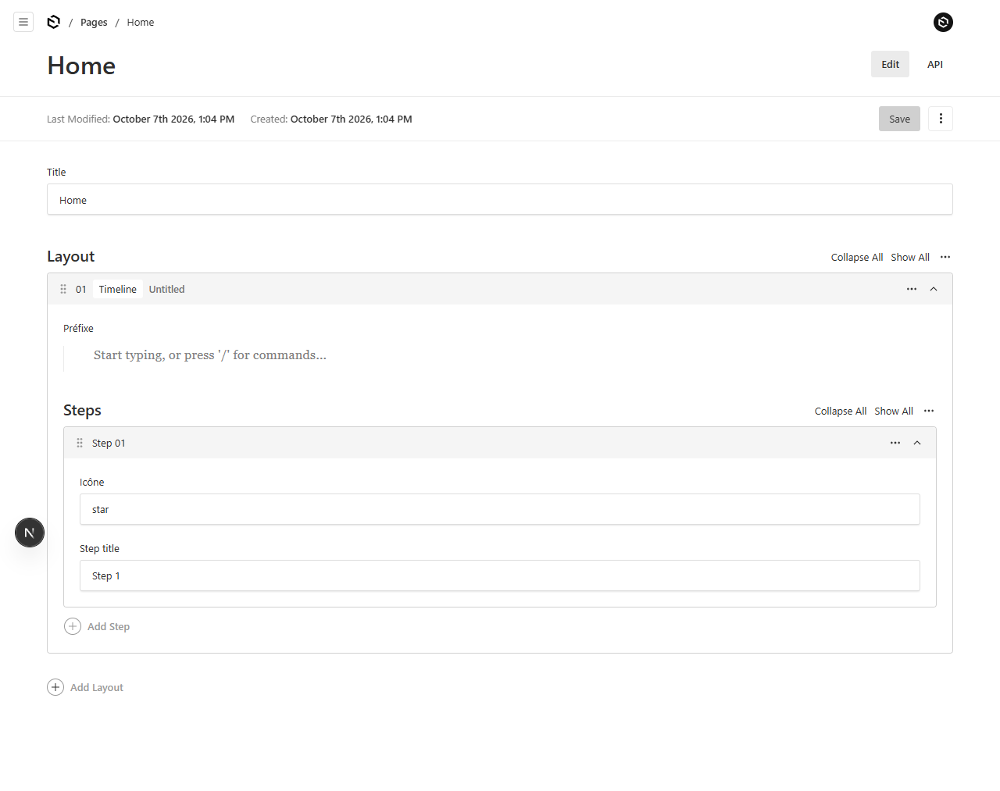

# Payload 3 Reproductions

> \[!IMPORTANT\]
>
> Please make sure that you do not modify the .env.example’s DATABASE_URI

This repository uses SQLite and pushes the file `payload.db` to github, with the first user created for `autoLogin` and any initial data necessary for respective branch reproductions.

## Reproduction: field labels rendered in the wrong admin language

`getClientSchemaMap` (`@payloadcms/ui/utilities/getClientSchemaMap`) caches the client field
schema map per collection/global slug only — the admin language is not part of the cache key.
Client fields are created with the `i18n` of the request that fills the cache, so `LabelFunction`
labels (and any other server-translated props) are frozen in that first language for every user
until the process restarts.

Fields rendered through form state with the cached client field — `richText` and fields with a
custom `Field` component — show the cached language; plain fields render from `getClientConfig`,
which *is* cached per language, so they stay correct. This is why only some labels are wrong.

Setup: `src/payload.config.ts` (i18n `en` + `fr` with custom `repro:*` keys) and
`src/collections/Pages.ts` (all labels are `({ t }) => t('repro:…')`). `payload.db` contains a
`Home` page with a `timeline` block.

Steps:

1. `pnpm dev` (fresh process)
2. Account → Language → **Français** (or set cookie `payload-lng=fr`)
3. Open Pages → Home — all labels French (correct, this fills the cache)
4. Account → Language → **English**, reload Pages → Home

Expected: `Title`, `Prefix`, `Icon`, `Step title`

Actual: `Title`, **`Préfixe`**, **`Icône`**, `Step title`

In production with multiple instances each process locks in whichever language hits it first, so
the wrong language appears intermittently and "fixes itself" on reload when the request lands on
another instance.
